# Sơ đồ 2 — Luồng nghiệp vụ chi tiết từng tính năng

> Thuộc bộ tài liệu bắt đầu từ [`SO-DO-TONG-QUAN.md`](SO-DO-TONG-QUAN.md) (xem mục 0 về ký hiệu ✅ ⚠️ ❓ ❌). Tiền: **mọi thứ là ĐỒNG** (Chi tiêu, Quỹ, Chia bill, Công nợ).
> Chỉ mô tả chức năng **có trong code**. Chức năng không có được ghi rõ là ❌.

Mục lục: [A. Chi tiêu cá nhân](#a-chi-tiêu-cá-nhân) · [B. Quỹ nhóm](#b-quỹ-nhóm) · [C. Chia bill](#c-chia-bill) · [D. Công nợ](#d-công-nợ) · [E. Lịch sử giao dịch](#e-lịch-sử-giao-dịch) · [F. Tổng quan](#f-tổng-quan)

---

## A. Chi tiêu cá nhân

**Màn hình:** `ExpensesTab` (tab), `ExpenseFormScreen` (`/chi-tieu/nhap`), `ExpenseDetailScreen` (`/chi-tieu/chi-tiet`), `HistoryScreen` (`ExpenseRow` dùng lại; route `/lich-su` ❌ không có nơi gọi).
**Kho:** `sct:m:YYYY-MM` (đồng) + `sct:settings`. **Repository:** `src/data/expenseRepository.ts` (ghi trực tiếp, **không** qua `*Synced`).

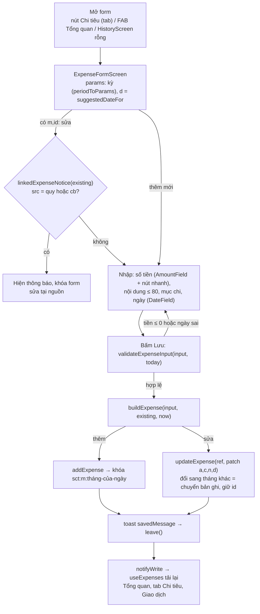

**Xem – sửa – xóa (lịch sử trong tab Chi tiêu):** `useExpenses(period)` → `groupByDay(filterByCategory(...))`; thẻ biểu đồ tròn `ExpenseCategoryOverview` (`summarizeByCategory`, `donutSegments`) và `ChipRow` lọc mục (giữ bằng `usePersistedState`, chỉ trong phiên chạy).

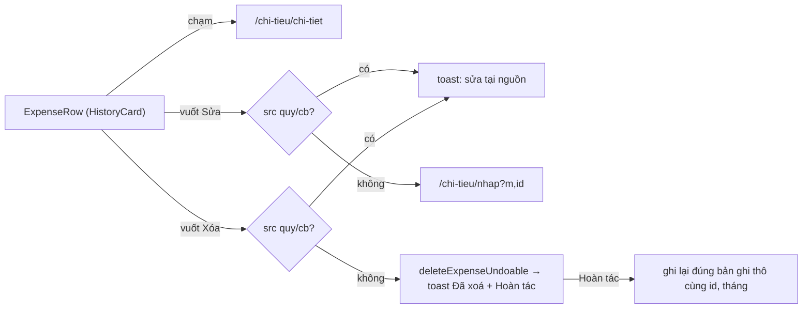

| Điểm | Chi tiết (✅ theo code) |
|---|---|
| Nơi tính | `src/domain/expenses.ts`: `buildExpense`, `validateExpenseInput`, `isInPeriod`, `sumAmounts`, `groupByDay`, `summarizeByCategory`, `budgetSummary` |
| Nơi kiểm tra | UI: `validateExpenseInput`; kho: `addExp` (`expenseApi`) ném `ExpenseInputError`; sửa/xóa khoản tự sinh: **chỉ chặn ở UI** (`linkedExpenseNotice`), `expenseRepository.updateExpense/deleteExpense` không kiểm `src` (xem R-5) |
| Bản ghi liên kết | Không có (khoản tự nhập không có `src`). Khoản có `src` do `billSync`/`fundSync` quản lý |
| Ảnh hưởng sau lưu | Tổng quan (thẻ tổng chi, ngân sách, Chi tiêu, Giao dịch gần đây), tab Chi tiêu, `/giao-dich` |
| Cài đặt liên quan | `SettingsScreen`: `setBudget` (theo tháng, áp dụng cho các tháng sau), mục chi tự thêm (`addCustomCategory`), danh sách người; ghi qua `saveSettings`/`addPersonToList` |

---

## B. Quỹ nhóm

**Màn hình:** `FundListScreen` (tab), `FundExpenseScreen` → `FundExpensePanel` → `ContributionForm` / `FundExpenseForm` (`/quy/thu-quy`, `/quy/chi-tieu`), `FundHistoryScreen`, `FundEntryDetailScreen`, `FundEntryEditScreen`, `FundPersonDebtScreen`, `FundAdvanceActionScreen` (+ `FundActionSheet`, `FundPayFlow`, `AdvanceSpendCard`).
**Kho:** `quy_nhom_v1` (đồng): `funds, contribs, expenses, advances, fundTxns, cur`. **Ghi:** `fundService.*Synced` → `fundRepository` (`mutate` = đọc bản thô, sửa, ghi lại; khóa lạ giữ nguyên).

### B1. Mô hình dữ liệu quỹ (✅ `src/types/fund.ts`, đối chiếu `fundRepository`)

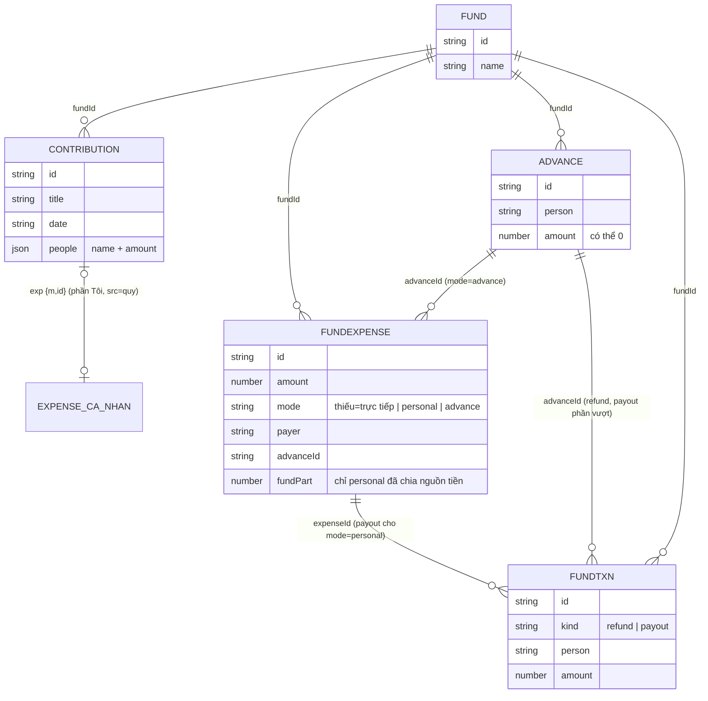

Hồ sơ ứng trước **không lưu trạng thái**: `advanceSummary` (`src/domain/fundAdvance.ts`) tính `balance = given − spent − refunded + paidExtra`; `balance > 0` = cá nhân còn giữ (`held`), `< 0` = quỹ nợ (`owed`).

### B2. Thu quỹ (đóng quỹ)

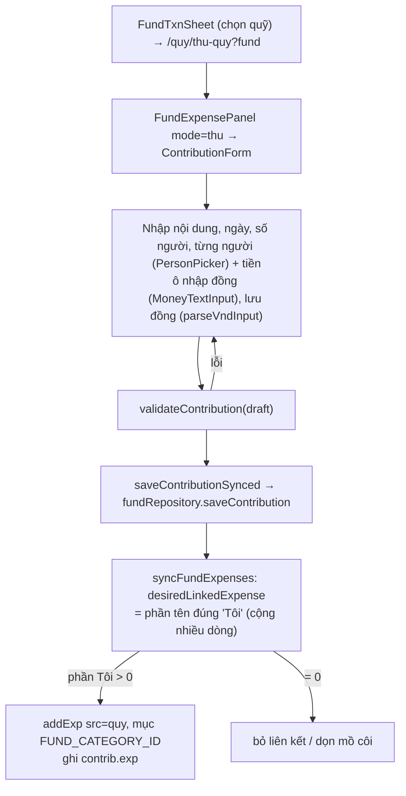

Sửa lần đóng: `/quy/sua?kind=contribution` → cùng `ContributionForm`. Xóa: vuốt Xóa ở `FundHistoryScreen` → `deleteContributionSynced` (khoản chi cá nhân mồ côi được `fundSync` dọn).

### B3. Chi quỹ – ba hình thức (`FundExpenseForm`, `KIND_OPTIONS`) + lựa chọn "Quỹ giao tiền A chi"

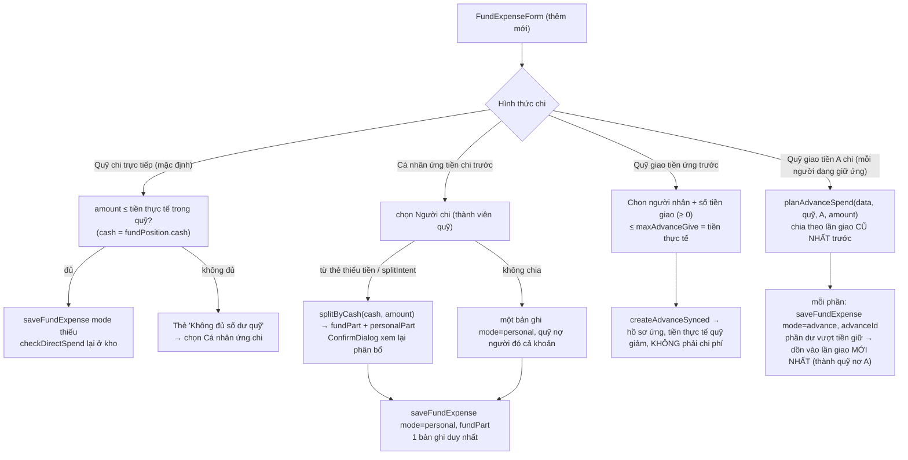

Ý nghĩa tiền (`fundAdvance.ts`): tổng chi thực tế tính **mỗi khoản chi đúng một lần**; số dư quỹ (`fundBalance`) = thu − chi; **tiền thực tế** (`fundCash`/`fundPosition.cash`) = thu − chi trực tiếp (và phần `fundPart`) − tiền đã giao ứng + đã hoàn − quỹ đã trả cho cá nhân. Giao ứng, hoàn tiền, thanh toán **không phải chi phí**.

### B4. Công nợ quỹ theo người – hai phía (`FundPersonDebtScreen`, `fundPerson.ts`)

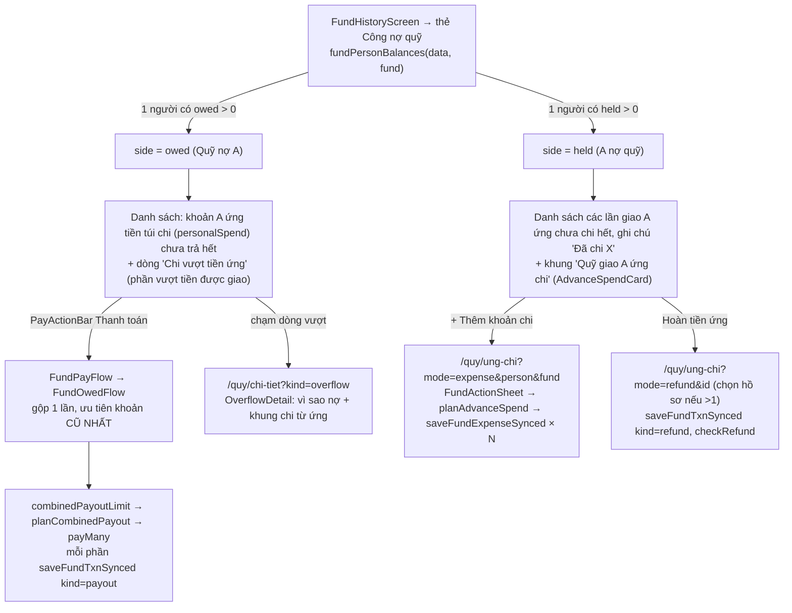

`FundPayFlow` còn nhánh `FundSingleFlow` (chọn từng khoản) nhưng `FundPersonDebtScreen` luôn truyền `side` và tắt thanh toán ở phía `held`, nên nhánh này chỉ chạy khi mở route **không có `side`** (⚠️ không thấy nơi gọi như vậy trong app).

**Tình huống đặc biệt**

| Tình huống | Xử lý (nơi) |
|---|---|
| Chi trực tiếp vượt tiền thực tế | Chặn: `checkDirectSpend` (UI + `saveFundExpense`); gợi ý chuyển sang "Cá nhân ứng chi" |
| Giao ứng vượt tiền thực tế | `checkAdvanceGive`/`maxAdvanceGive` |
| Hoàn tiền quá số đang giữ / thanh toán quá số nợ | `checkRefund` / `checkPayout` (UI trong `FundActionSheet`, lại trong `saveFundTxn`) |
| Xóa khoản chi cá nhân ứng đã có thanh toán | Chặn: "hãy xoá thanh toán trước" (`deleteFundExpense`) |
| Xóa hồ sơ ứng đã có chi/hoàn/thanh toán | Chặn (`deleteAdvance`) |
| Xóa cả quỹ | Xóa `contribs, expenses, advances, fundTxns` của quỹ; chi tiêu cá nhân `src:'quy'` thành mồ côi, `fundSync` dọn |
| Bấm lưu nhiều lần / thử lại | `clientId` sinh một lần mỗi lần mở form → không ghi trùng (`saveFundExpense`, `saveFundTxn`) |

**Cập nhật sau mọi thao tác quỹ:** `fundService.*Synced` → `syncFundExpenses` → `notifyWrite(quy_nhom_v1)` → `useFundData` (mọi màn quỹ, kể cả đang nằm sau) tải lại; Tổng quan: thẻ `FundStatCard` (tổng `fundBalance`).

---

## C. Chia bill

**Màn hình:** `BillCalcScreen` (`/chia-bill/tao`, `/chia-bill/sua`), `BillHistoryScreen` (tab + `/chia-bill/lich-su`), `BillDetailScreen`, `BillPaymentScreen`, (`PersonBillsScreen` ❌ không có nơi gọi).
**Kho:** `chiabill:v2:bills` (+ `chiabill:names`), thanh toán ghi vào `chiabill:v2:pays`. **Tiền: đồng** (dữ liệu cũ nghìn đồng được chuyển một lần, xem `SO-DO-TONG-QUAN.md` mục 3.4).

### C1. Tạo / sửa bill

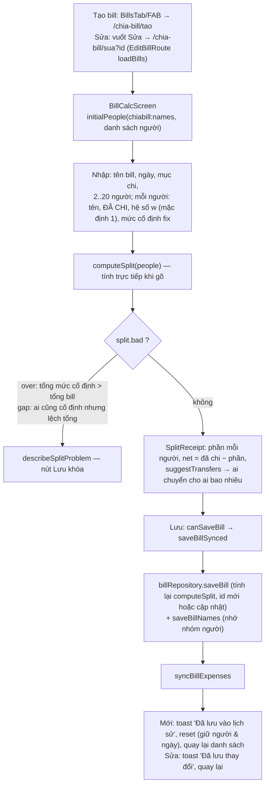

**Quy tắc `computeSplit`** (`src/domain/bills.ts`): người có `fix` trả đúng mức; phần còn lại của tổng bill chia cho người còn lại theo hệ số `w` (tổng hệ số 0 → chia đều); `net = paid − share` (dương = nhận lại, âm = còn thiếu); `suggestTransfers` ghép chủ nợ – con nợ thành các `Transfer {from,to,amt}`. Khi `bad` thì **không có** gợi ý chuyển.

### C2. Phần chi tiêu cá nhân sinh từ bill

`desiredBillExpense(bill)`: nếu có người tên đúng `Tôi` và bill không lỗi → khoản `src:'cb'`, số tiền = `Math.round(min(đã chi, phần phải trả))` của "Tôi", mục = `bill.cat`, ghi chú `i` có "Trả trước …" nếu đã chi ít hơn phần mình. Liên kết lưu ở `bill.exp`.

### C3. Danh sách – chi tiết – thanh toán

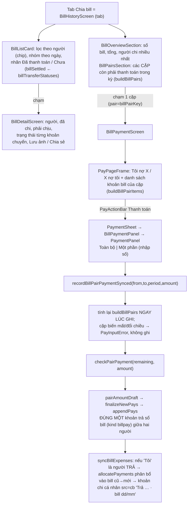

**Phân bổ khoản thanh toán vào từng bill:** *không lưu* phân bổ. Mỗi lần hiển thị, `billTransferStatuses` (`src/domain/billPayment.ts`) duyệt bill + khoản trả theo thứ tự (ngày, `createdAt`), mỗi khoản trả `from→to` trừ dần vào các khoản "from phải chuyển cho to" **bill cũ trước**. Trạng thái bill: `paid | partial | unpaid` từng khoản; `billSettled` = mọi khoản đã trả. Lưu ý có **3 bản cài đặt cùng quy tắc FIFO** (xem `SO-DO-TAI-SU-DUNG.md`, mục 5).

**Xóa bill:** vuốt Xóa → `deleteBillSynced` → `syncBillExpenses` dọn khoản chi `src:'cb'` mồ côi (chỉ khi không bill nào và không khoản trả nào trỏ tới).

---

## D. Công nợ

**Màn hình:** `DebtsTab`, `DebtDetailScreen` (`/cong-no/chi-tiet`), `PayFormScreen` (`/cong-no/ghi-nhan`, `/cong-no/sua`), `PayDetailScreen`, `PayTransactions` (lịch sử trong tab). **Kho:** `chiabill:v2:pays` + `bills`. **Đồng.**

### D1. Hai sổ và cách tính số dư

Không lưu số dư. `debtEvents(bills, pays)` (`src/domain/ledger.ts`) tạo mọi biến động liên quan "Tôi": gợi ý chuyển của từng bill (sổ `bill`) và khoản trả (sổ `loan` nếu kiểu vay, `bill` nếu kiểu trả bill, `bt` = gộp nợ thuộc sổ `led`). `personLedger(events, name)` → `{loan, bill}`; dương = người đó nợ tôi.

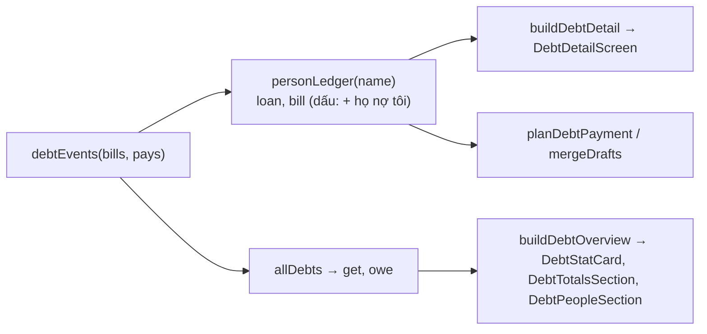

### D2. Ghi nhận giao dịch (nợ vay / trả bill)

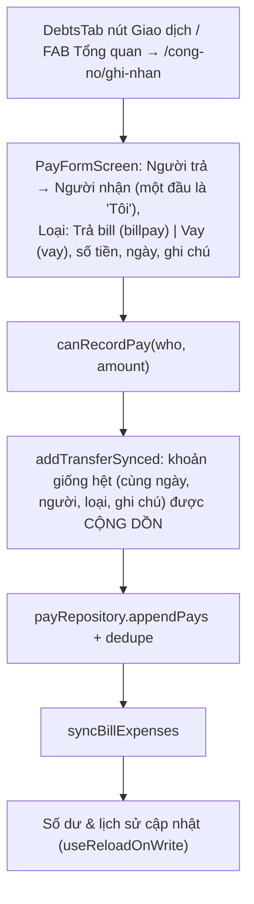

Sửa: `/cong-no/sua?ids` → `updateTransferSynced` (một khoản) hoặc `updatePayGroupSynced` (nhóm hiển thị chung, thay bằng một khoản `repay`). Xóa: `deletePaySynced(ids)`.

### D3. Thanh toán với một người (`DebtDetailScreen`) – "toàn bộ" / "một phần"

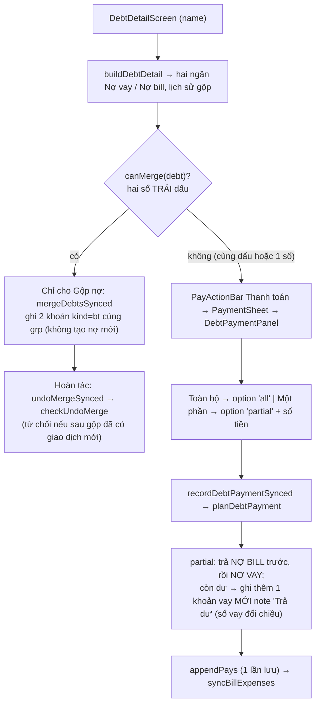

UI chỉ dùng hai lựa chọn `all` và `partial`; `planDebtPayment` còn hỗ trợ `bill` và `loan` nhưng ✅ không có nơi gọi hai lựa chọn này trong `features/`.

### D4. Một người vừa nợ vay vừa nợ bill

- **Cùng dấu** (cả hai họ nợ tôi hoặc cả hai tôi nợ họ): thanh toán một phần chia theo thứ tự bill → vay → dư (D3).
- **Trái dấu**: `planDebtPayment` trả `[]` ("phải Gộp nợ trước, không tự bù trừ"); UI chỉ hiện Gộp nợ. Số tiền gộp = `mergeAmount(debt)`.

### D5. Chi tiêu cá nhân sinh từ công nợ

Khi **"Tôi" trả bill** hoặc gộp nợ làm giảm nợ bill của tôi: `planDebtExpenseSync`/`allocatePayments` (`src/domain/payExpenses.ts`) trừ số tiền đó dần vào các bill tôi còn nợ người ấy (bill cũ trước), mỗi phần thành khoản chi cá nhân `src:'cb'` (mục = mục của bill, `i` = "Trả <ai> · bill dd/mm" hoặc "Bù trừ nợ ..."). Liên kết lưu ở `pay.exp[]`. **Khoản vay không sinh chi tiêu.** Nhận tiền (người khác trả tôi) cũng không sinh chi tiêu.

---

## E. Lịch sử giao dịch

Không có kho "lịch sử" riêng. Mỗi màn dựng lịch sử từ kho gốc bằng hàm thuần, dùng chung giao diện `HistoryCard` (`SwipeRow` + `TransactionRow`).

| Lịch sử | Nguồn dữ liệu | Hàm dựng | Bộ lọc | Thao tác trên dòng | Bảo vệ |
|---|---|---|---|---|---|
| Chi tiêu (tab) | `sct:m:*` | `groupByDay(filterByCategory(...))` | kỳ dùng chung; chip mục chi | chạm → chi tiết; vuốt Sửa/Xóa (+Hoàn tác) | `linkedExpenseNotice` khóa khoản `src quy/cb` |
| Giao dịch (`/giao-dich`, trong Tổng quan) | chi tiêu cá nhân + `pays` | `buildRecentTransactions` | kỳ (cửa sổ + `filterPeriod`) | chỉ xem | Bỏ khoản chi `cb` là "bóng" của khoản trả (`pay.exp`) để không đếm đôi |
| Bill (tab) | `bills` | `buildBillHistory`, `filterBillsByPerson` | kỳ; chip người | chạm/Sửa/Xóa | xóa → dọn chi tiêu `cb` |
| Giao dịch Công nợ (`PayTransactions`) | `pays` | `buildPayHistory`, `filterPayDays`, `filterPayDaysByPerson` | kỳ; chip Trả bill/Chuyển tiền; chip người | chạm → `PayDetailScreen`; Sửa; Xóa | gộp nợ `bt` không hiện; hoàn tác gộp chỉ ở chi tiết nợ |
| Quỹ | `quy_nhom_v1` | `buildFundHistory`, `filterCashMovementDays`, `mergePayoutEntries`, `filterDaysByPerson` | kỳ; chip thành viên | chạm → `FundEntryDetailScreen`; vuốt Sửa → `FundEntryEditScreen`; Xóa | các chặn xóa ở mục B |

**Giao dịch tạo tự động từ nghiệp vụ khác:** (1) `src:'quy'` từ thu quỹ phần "Tôi"; (2) `src:'cb'` từ bill (phần "Tôi") và từ khoản trả nợ bill; (3) khoản gộp nợ `bt` (2 khoản cùng `grp`). Cả (1) và (2) **chỉ sửa/xóa tại nguồn**.

---

## F. Tổng quan

`OverviewScreen` đọc: `useExpenses(period)`, `useExpenseSettings`, `useDebtData` (bills + pays + người), `useFundData` (đếm có quỹ, `FundStatCard`).

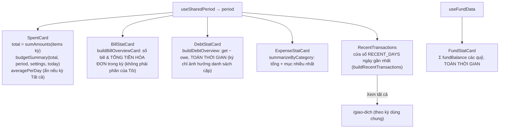

| Thẻ | Phụ thuộc kỳ? | Nguồn | Ghi chú |
|---|---|---|---|
| Đã chi (SpentCard) | Có | `sct:m:*` | Gồm khoản `src quy/cb` (phần "Tôi") |
| Chia bill | Có | `bills` | Tổng tiền các bill, khác với chi tiêu cá nhân |
| Công nợ | **Không** (số dư) | `bills`+`pays` | Hiển thị dạng `+/−` và "Tôi nợ / Nợ tôi" |
| Chi tiêu | Có | chi tiêu cá nhân | |
| Quỹ nhóm | **Không** | `quy_nhom_v1` | Tổng số dư, số quỹ |
| Giao dịch gần đây | Cửa sổ ngày gần đây | chi tiêu + pays | Dòng **không bấm được**; chỉ nút "Xem tất cả" |

Các thẻ `SummaryCard` **không điều hướng** (✅ `SummaryCard` không có `onPress`); điều hướng từ Tổng quan chỉ có: nút cài đặt, "Xem tất cả" và nút nổi +. Cập nhật sau khi dữ liệu đổi: các hook (`useExpenses`, `useDebtData`, `useFundData`) đều đăng ký `useReloadOnWrite` nên thẻ đổi ngay kể cả khi Tổng quan đang nằm phía sau.
