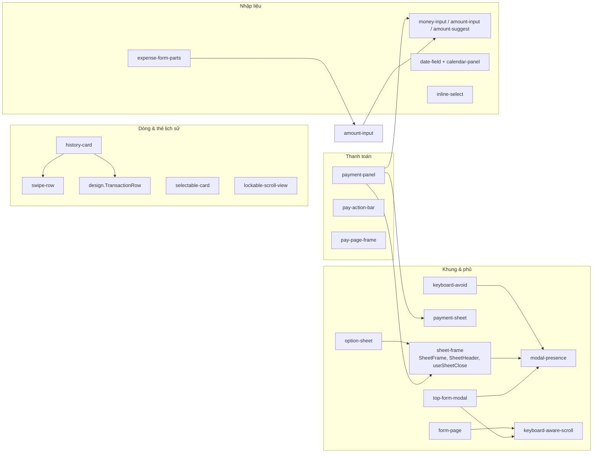
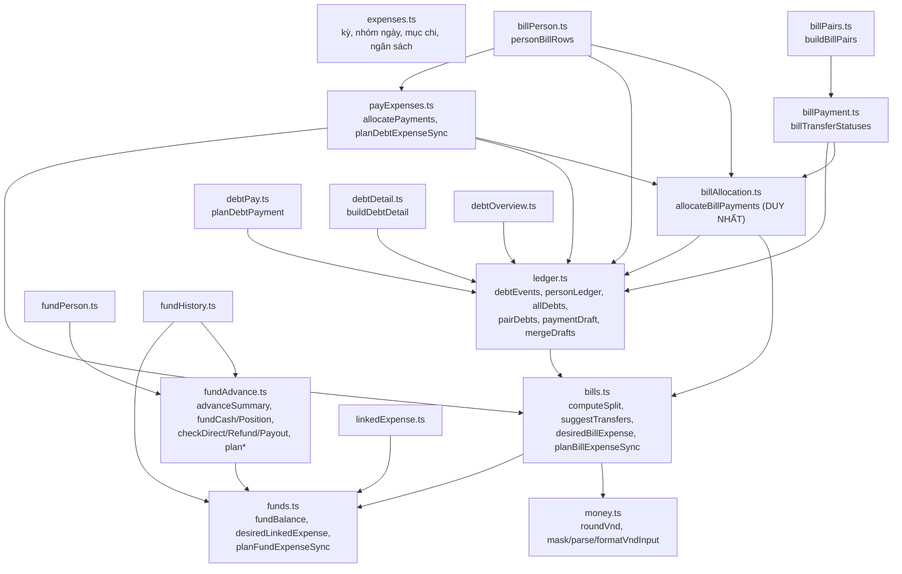

# Sơ đồ 4 & 5 — Tái sử dụng component và logic nghiệp vụ

> Thuộc bộ tài liệu bắt đầu từ [`SO-DO-TONG-QUAN.md`](SO-DO-TONG-QUAN.md). Cột "dùng bởi" được lập bằng `grep -rl "from '@/components/<tên>'"` (và tìm tên hàm) trên `src`, **loại file test**: tức là quan hệ **import thực tế**, không suy từ giao diện giống nhau.
> Ký hiệu: ✅ đã đối chiếu code · ⚠️ suy từ đọc code · ❌ chết/không có nơi gọi/trùng.
> Phân biệt: **UI** = chỉ trình bày/chuyển tiếp sự kiện; **UI+logic** = có tự kiểm tra, tính toán, ghi dữ liệu hoặc điều hướng bên trong.

---

## 1. Sơ đồ 4 — Component dùng chung

### 1.1 Sơ đồ phụ thuộc (các cụm chính)

### 1.2 Bảng tra từng component trong `src/components/`

| Component (file) | Chức năng | Dùng bởi (import thực tế) | Props/dữ liệu chính | Callback | UI hay UI+logic |
|---|---|---|---|---|---|
| `design.tsx` | Bộ khối giao diện (xem 1.3) | hầu hết `features/*` | — | — | UI (gồm `ConfirmDialog`) |
| `history-card.tsx` `HistoryCard` | Một dòng lịch sử: `SwipeRow` bọc `TransactionRow`, đệm ngang 12 | `BillListCard`, `PayHistoryScreen`, `HistoryScreen`, `AdvanceSpendCard`, `FundHistoryScreen` (+ `FundEntryIcon` dùng `IconTile`) | `open`, `icon`, `title`, `subtitle`, `amount`, `tone`, `badge`, `badgeTone`, `locked` | `onOpen/onClose/onPressRow/onEdit/onDelete/onPressLocked` | UI (chỉ chuyển tiếp, không tính tiền) |
| `swipe-row.tsx` `SwipeRow` | Vuốt trái hiện Sửa/Xóa (Xóa bấm hai lần), chạm dòng | `history-card`, `FundListScreen` (trực tiếp) | `open`, `locked`, `background`, `radius` | như trên | UI + quy tắc vuốt (`domain/swipe.ts`) |
| `lockable-scroll-view.tsx` | `ScrollView` giữ chiều cao khi chuyển thẻ lọc | `BillHistoryScreen`, `DebtsTab`, `PayHistoryScreen`, `ExpensesTab`, `HistoryScreen`, `FundHistoryScreen`, `FundListScreen` | `ScrollViewProps` | — | UI |
| `selectable-card.tsx` | Thẻ chạm để chọn/bỏ chọn | `BillPairsPanel`, `DebtPeoplePanel`, `FundHistoryScreen` | `selected`, `onPress` | `onPress` | UI (đi cùng `useSelectionFilter`) |
| `sheet-frame.tsx` | Khung tờ trượt đáy / giữa màn, nền mờ | `option-sheet`, `payment-panel`, `period-filter`, `FundPayFlow`, `FundPersonDebtScreen`, `FundTxnSheet` | `placement`, `keepScrim`, `maxHeight`, `onClose` | `useSheetClose()` trả `hide(after)` | UI |
| `option-sheet.tsx` | Tờ chọn danh sách hành động | `AddExpenseFab`, `FundListScreen` | `title`, `options[]`, `note` | `option.onPress` | UI |
| `payment-sheet.tsx` | Tờ nổi Thanh toán + tóm tắt | `payment-panel`, `BillPaymentScreen`, `DebtDetailScreen`, `FundPayFlow` | `heading`, `amountText`, `amountColor` | `onClose` | UI |
| `payment-panel.tsx` `PaymentPanel` | Hai nút Toàn bộ/Một phần → thẻ xác nhận/nhập số | `BillPairsPanel`, `PersonBillsScreen`, `DebtPeoplePanel`, `FundPayFlow` | `remaining`, `choices[]`, `payer`, `receiver` | `onPay(amount,id)`, `onDone`, `onFailure` | **UI+logic**: tự kiểm số tiền nhập (`checkAmount`: > 0 và ≤ số còn lại) |
| `pay-action-bar.tsx` | Nút Thanh toán cố định đáy trang | `BillPaymentScreen`, `DebtDetailScreen`, `FundPersonDebtScreen` | `visible`, `label`, `bottom` | `onPress` | UI |
| `pay-page-frame.tsx` | Thẻ tổng + danh sách khoản của trang thanh toán | cùng 3 màn trên | `label`, `amount`, `amountColor`, `caption`, `detailsTitle`, `detailsCount` | — | UI |
| `period-filter.tsx` | Chọn kỳ (Tháng/Năm/Tất cả/Tuỳ chọn) | `PeriodBar`, `FundHistoryScreen` | `view`, `today`, `compact`, `onSettings` | `onChange(view)` | UI + dùng `periodOf`, `DateField`, `CalendarPanel` |
| `money-input.tsx` / `amount-input.tsx` / `amount-suggest.tsx` | Ô tiền có dấu chấm, gợi ý ×1.000/10.000/100.000 | `money-input`: `payment-panel`, `BillCalcScreen`, `PayFormScreen`, `SettingsScreen`, `ContributionForm`; `amount-input`: `expense-form-parts`, `FundActionSheet`, `FundExpenseForm` | `value`, `onChangeValue` | — | UI + `amountSuggestions` |
| `date-field.tsx` + `calendar-panel.tsx` | Ô ngày dd/mm/yyyy + lịch tự dựng | `BillCalcScreen`, `PayFormScreen`, `ExpenseFormScreen`, `ContributionForm`, `FundActionSheet`, `FundExpenseForm`, `period-filter` | `value`, `today`, `min/max` | `onPress`, `onConfirm` | UI + `domain/calendar.ts` |
| `expense-form-parts.tsx` | `FormLabel`, `QuickButton`, `QUICK_ADDS` (nút +10k…) | `ExpenseFormScreen`, `FundExpenseForm`, `FundExpensePanel` | — | — | UI |
| `inline-select.tsx` | Ô chọn xổ xuống trong khung | `FundExpenseForm`, `FundExpensePanel` | `options`, `selectedKey` | `onSelect` | UI |
| `category-icon.tsx` | Biểu tượng mục chi | `BillCalcScreen`, `BillDetailScreen`, `BillImage`, `BillListCard`, `ExpenseDetailScreen`, `ExpenseFormScreen`, `HistoryScreen`, `RecentTransactions`, `SettingsScreen` | `category`, `size` | — | UI |
| `detail-parts.tsx` | `DetailHero/Field/Notice` cho trang chi tiết | `PayDetailScreen`, `FundEntryDetailScreen`, `FundPersonDebtScreen` | — | — | UI (`ExpenseDetailScreen`, `BillDetailScreen` không dùng, có phần giao diện chi tiết riêng) |
| `form-page.tsx` | Khung trang biểu mẫu (tiêu đề + thẻ trắng) | `FundActionSheet`, `FundEntryEditScreen` | `title`, `children` | — | UI |
| `top-form-modal.tsx` | Biểu mẫu phủ toàn màn hình | chỉ `FundActionSheet` (khi không `asPage`) | `title` | `onClose` | UI |
| `keyboard-avoid.tsx`, `keyboard-aware-scroll.tsx`, `modal-presence.tsx` | Né bàn phím, đếm Modal đang mở | `_layout.tsx`, `design`, `top-form-modal`, `DataSheet`, `form-page`, nhiều form | — | — | UI (trạng thái toàn cục `isModalOpen`) |
| `floating-tabs.tsx`, `app-tabs.tsx` | Thanh tab dưới | `(tabs)/_layout` | — | — | UI |
| `toast.tsx` | Thông báo nổi + nút hành động | `_layout` (Provider) và ~20 màn | `show(text,{bottom,action})` | `action.onPress` | UI |
| `svg-icon.tsx`, `app-text.tsx` | Biểu tượng nét / chữ | gần như mọi nơi | `name`, `size`, `color` | — | UI |

### 1.3 Các khối trong `design.tsx` (ai thật sự dùng — ✅ `grep` theo tên)

| Khối | Dùng bởi | Ghi chú |
|---|---|---|
| `ScreenTitle` | mọi màn có tiêu đề (≈25 file, kể cả 4 route con `app/chia-bill/*`, `app/cong-no/*`) | |
| `TitleAction` | `BillsTab`, `DebtsTab`, `ExpensesTab`, `FundListScreen` | nút ở hàng tiêu đề |
| `SectionCard`, `CardHead` | `BillPairsPanel`, `DebtPeoplePanel`, `RecentTransactions`, `AdvanceSpendCard`, `FundHistoryScreen`; `BillListCard`, `PayTransactions`, `ExpenseCategoryOverview`, `ExpensesTab`, `TransactionsScreen`, `FundHistoryScreen` | |
| `SummaryCard` | `BillStatCard`, `DebtStatCard`, `ExpenseStatCard`, `FundStatCard` | **không bấm được** |
| `Panel`, `PersonAmountRow`, `StatusBadge`, `SectionHeader`, `EmptyState`, `ChipRow`, `PrimaryButton`, `SecondaryButton` | nhiều màn | |
| `TransactionRow` | `history-card`, `PersonBillsScreen`, `RecentTransactions` | |
| `SegmentedControl` | `period-filter` | |
| `ConfirmDialog` | chỉ `FundExpenseForm` | |
| `NavTile` | chỉ `DebtOverviewCards.PaysEntry` (❌ không dựng) | |
| `HeroCard`, `ModalHeader` | ❌ không có nơi dùng ngoài định nghĩa | mã chết |

### 1.4 Component cấp tính năng được dùng lại giữa màn hình

| Component | File | Dùng ở | Chứa logic? |
|---|---|---|---|
| `ExpenseRow` | `features/expenses/HistoryScreen.tsx` | `ExpensesTab` (và `HistoryScreen`) | UI (khóa dòng bằng `linkedExpenseNotice`) |
| `useExpenseRowActions` | `features/expenses/useExpenseRowActions.ts` | `ExpensesTab`, `HistoryScreen` | **Có**: điều hướng, xóa + hoàn tác, chặn khoản tự sinh |
| `PayRowView` | `features/debts/PayHistoryScreen.tsx` | `PayTransactions`, `PayHistoryScreen` | **Có**: điều hướng Sửa/chi tiết |
| `BillListCard` | `features/bills/BillListCard.tsx` | `BillHistoryScreen` (cả tab và trang riêng) | **Có**: điều hướng chi tiết/sửa |
| `BillPaymentPanel` | `features/bills/BillPairsPanel.tsx` | `BillPaymentScreen` | **Có**: gọi `recordBillPairPaymentSynced` |
| `DebtPaymentPanel`, `debtPaySummary` | `features/debts/DebtPeoplePanel.tsx` | `DebtDetailScreen` | **Có**: gọi `recordDebtPaymentSynced` |
| `AdvanceSpendCard` | `features/funds/AdvanceSpendCard.tsx` | `FundPersonDebtScreen`, `FundEntryDetailScreen` | **Có**: xóa (`deleteFundExpenseSynced`) + toast + điều hướng; `advanceSpendItems` là bộ lọc dùng chung |
| `FundActionSheet` | `features/funds/FundActionSheet.tsx` | `FundAdvanceActionScreen`, `FundEntryEditScreen` (cả hai với `asPage`) | **Có**: kiểm tra + ghi (`saveFundExpenseSynced`, `saveFundTxnSynced`, `updateFundTxnSynced`) |
| `FundExpenseForm`, `ContributionForm` | `features/funds/` | `FundExpensePanel`, `FundEntryEditScreen` | **Có**: toàn bộ luồng chi/thu quỹ |
| `PersonPicker`, `MemberPicker` | `features/people/` | `ContributionForm`, `FundExpenseForm`; `BillCalcScreen` | UI + đọc/ghi danh sách người (`peopleRepository`) |
| `FundEntryIcon` | `features/funds/` | `FundHistoryScreen` | UI |
| `MemberFilterChips` | `features/funds/` | `FundHistoryScreen` | UI |

---

## 2. Sơ đồ 5 — Logic nghiệp vụ dùng chung

### 2.1 Bản đồ phụ thuộc giữa các module `domain/`

(Mũi tên = "import". `bills.ts` import `funds.ts` chỉ để dùng hằng `FUND_OWNER_NAME`.)

### 2.2 Bảng logic dùng chung (hàm → ai gọi)

| Logic | Hàm / file | Đầu vào → đầu ra, quy tắc chính | Dùng bởi (✅ import thực tế) |
|---|---|---|---|
| **Chia tiền bill** | `computeSplit` — `domain/bills.ts` | `people[{paid,w,fix}]` → `rows[{share,net}]`, `transfers`, `bad`. Mức cố định trả đúng mức; phần còn lại theo hệ số | `BillCalcScreen`, `BillDetailScreen`, `BillImage`, `BillListCard`, `billRepository.saveBill`, `billHistory`, `billPayment`, `ledger` |
| Cho phép lưu bill | `canSaveBill` | `total>0`, `n≥2`, `!bad` | `BillCalcScreen`, `billRepository.saveBill` (kiểm tra lại ở kho) |
| Làm tròn / ô nhập tiền | `roundVnd`, `maskVndInput`, `parseVndInput`, `formatVndInput` — `domain/money.ts` | tất cả là ĐỒNG nguyên | `ledger`, `billPerson`, `billPayment`, `billPairs`, `debtPay`, `payForm`, `billForm`, `billHistory`, form Quỹ/Bill/Công nợ |
| Chuyển dữ liệu cũ (nghìn → đồng) | `billsNghinToVnd`, `paysNghinToVnd`, `nghinToVnd` — `domain/moneyMigration.ts`; `ensureVndUnits` — `data/moneyMigration.ts` | nhân 1000 một lần, có dự phòng | `billRepository.readBillsRaw`, `payRepository.readPaysRaw`, `backupRepository`, `domain/backup.parseBackup` |
| Hiển thị tiền | `formatVnd` — `utils/format.ts` (đã bỏ `formatMoney`) | | ~40 file |
| **Số dư công nợ** | `debtEvents` → `personLedger` / `allDebts` / `pairDebts` — `domain/ledger.ts` | biến động liên quan "Tôi"; hai sổ vay/bill | `debtDetail`, `debtOverview`, `billPayment`, `billPerson`, `payExpenses`, `payService` |
| Thanh toán công nợ | `planDebtPayment` (`debtPay.ts`), `paymentDraft`, `mergeDrafts`, `finalizeNewPays` (`ledger.ts`) | bản nháp khoản trả | `payService`, `DebtPeoplePanel` |
| **Trạng thái trả bill (mọi cặp)** | `billTransferStatuses` — `billPayment.ts` | FIFO bill cũ → mới theo cặp `from→to` | `billPairs`, `BillHistoryScreen`, `BillDetailScreen`, `BillImage` |
| Cặp cần thanh toán | `buildBillPairs`/`buildBillPairItems` — `billPairs.ts` | gộp hai chiều A→B, B→A thành một số còn lại | `BillHistoryScreen`, `BillPaymentScreen`, `payService.recordBillPairPaymentSynced` |
| **Phân bổ trả bill → chi tiêu cá nhân** | `allocatePayments` / `planDebtExpenseSync` — `payExpenses.ts` | chỉ khi "Tôi" trả; bill cũ trước | `billSync` (qua `planDebtExpenseSync`) |
| Chi tiêu cá nhân từ bill | `desiredBillExpense`, `planBillExpenseSync` — `bills.ts` | phần "Tôi" = min(đã chi, phải trả) | `payExpenses.planDebtExpenseSync` (bên trong) |
| Chi tiêu cá nhân từ quỹ | `desiredLinkedExpense`, `planFundExpenseSync` — `funds.ts` | phần tên "Tôi" của lần đóng | `data/fundSync.ts` |
| **Số dư/tiền quỹ** | `fundBalance` (`funds.ts`); `fundPosition`/`fundCash` (`fundAdvance.ts`) | `fundBalance` = thu − chi; `cash` loại trừ tiền cá nhân đang giữ/nợ | `FundListScreen`, `FundStatCard`, `FundTxnSheet`, `FundExpensePanel`, `FundHistoryScreen`, `FundExpenseForm`, `FundPayFlow` |
| Hồ sơ ứng trước | `advanceSummary` | `balance = given − spent − refunded + paidExtra` | `FundHistoryScreen`, `FundPersonDebtScreen`, `FundEntryDetailScreen`, `txnEditTarget`, … |
| Công nợ quỹ theo người | `fundPersonBalances`, `fundPersonTargets`, `buildPersonFundDetail` | hai phía `owed`/`held` | `FundHistoryScreen`, `FundPersonDebtScreen`, `FundPayFlow`, `AdvanceSpendCard` |
| Chia khoản chi từ ứng | `planAdvanceSpend` | lần giao cũ nhất trước; dư dồn vào lần mới nhất | `FundActionSheet`, `FundExpenseForm` (qua `planSpend`), `FundExpensePanel` |
| Thanh toán gộp quỹ nợ | `combinedPayoutLimit`, `planCombinedPayout` | khoản cũ nhất trước, mỗi quỹ ≤ tiền thực tế | `FundPayFlow` |
| Kiểm tra chi/hoàn/trả quỹ | `checkDirectSpend`, `checkRefund`, `checkPayout` | | `fundRepository` (bắt buộc); `checkRefund/Payout` thêm ở `FundActionSheet` |
| Kỳ & lọc ngày | `isInPeriod`, `periodOf`, `filterByPeriod`, `periodFromParams` — `expenses.ts` | | `billHistory`, `billPairs`, `billPerson`, `debtDetail`, `fundHistory`, `funds`, `ledger`, `payForm`, `periodFilter`, `useTransactionFeed`, `period-filter` |
| Gom theo ngày | `groupByDay` (`expenses.ts`) và `groupByDay` (`debtDetail.ts`) | **hai hàm cùng tên khác module** | chi tiêu / chi tiết nợ |
| Chặn sửa khoản tự sinh | `linkedExpenseNotice` — `linkedExpense.ts` | `src quy → câu của Quỹ; cb → câu của Bill` | `ExpenseFormScreen`, `ExpenseDetailScreen`, `HistoryScreen`, `useExpenseRowActions` |
| Giao dịch gần đây | `buildRecentTransactions` | gộp chi tiêu + pays, bỏ khoản "bóng" `pay.exp` | `useTransactionFeed` ← `RecentTransactions`, `TransactionsScreen` |

### 2.3 Hàng đợi và đồng bộ dùng chung (tầng `data/`)

| Cơ chế | File | Dùng bởi |
|---|---|---|
| Ghi + thông báo | `data/storage.ts` (`saveJson*`, `setRawMany`, `removeKeys`, `notifyWrite`) | mọi repository |
| Hàng đợi tuần tự theo kho | `serial()`/`tail` trong `expenseRepository`, `billRepository`, `payRepository`, `fundRepository` | repository tương ứng |
| Đồng bộ chi tiêu cá nhân | `billSync.syncBillExpenses` (= `syncDebtExpenses`), `fundSync.syncFundExpenses` | `billService`, `payService`, `fundService`, hook `useDebtData/useBills/useFundData` |
| Hợp đồng tạo/xóa chi tiêu tự sinh | `data/expenseApi.ts` (`addExp`, `delExp`, `getExp`, `listSrc`) | `billSync`, `fundSync`, `backupRepository.wipeSection` |
| Tự tải lại khi có ghi | `hooks/use-reload-on-write.ts` | `useFundData`, `useDebtData`, `useBills`, `useExpenses`, `useExpenseSettings`, `usePeople` |

---

## 3. Dùng chung UI ≠ dùng chung logic: các chỗ cần chú ý

| Cặp màn hình | Dùng chung UI | Logic tính tiền |
|---|---|---|
| Thanh toán bill / Công nợ / Quỹ (`PayPageFrame`, `PaymentSheet`, `PaymentPanel`, `PayActionBar`) | **Cùng** | **Khác nhau, đúng chủ ý**: bill → `buildBillPairs` + `recordBillPairPaymentSynced`; công nợ → `planDebtPayment` + `recordDebtPaymentSynced`; quỹ → `planCombinedPayout` + `saveFundTxnSynced`. Chỉ `PaymentPanel` chung phần nhập/xác nhận |
| Lịch sử chi tiêu / bill / giao dịch công nợ / quỹ (`HistoryCard`) | **Cùng** | Mỗi loại tự dựng bằng hàm riêng (`groupByDay`, `buildBillHistory`, `buildPayHistory`, `buildFundHistory`) |
| `AdvanceSpendCard` trên trang Nợ quỹ và chi tiết quỹ | **Cùng** + **cùng dữ liệu** (`advanceSpendItems`) | Cùng hàm, nên nhất quán |
| Số liệu "Tôi" của bill và của quỹ | — | Hai hàm riêng (`desiredBillExpense`, `desiredLinkedExpense`); cùng hằng `FUND_OWNER_NAME` nhưng **cách so tên khác** (xem R-6 ở `MA-TRAN-ANH-HUONG.md`) |

---

## 4. Mã chết / trùng lặp / không có nơi gọi (đã `grep`, loại test)

| Mục | Vị trí | Bằng chứng |
|---|---|---|
| ❌ `HeroCard`, `ModalHeader` | `components/design.tsx` | không file nào ngoài định nghĩa |
| ❌ `NavTile`, `PaysEntry`, `DebtPeopleSection` (bản trong `DebtOverviewCards.tsx`) | `features/debts/DebtOverviewCards.tsx` | `OverviewScreen` chỉ import `DebtStatCard` |
| ❌ **Trùng tên**: `DebtPeopleSection` có ở cả `DebtOverviewCards.tsx` (chết) và `DebtPeoplePanel.tsx` (đang dùng bởi `DebtsTab`) | | hai bản cài đặt song song |
| ❌ `BillDetailSection` | `features/bills/BillOverviewCard.tsx` | không file nào import; kéo theo route `/chia-bill/nguoi` mồ côi |
| ❌ `FundOverviewCard` (component đầy đủ) | `features/funds/FundOverviewCard.tsx` | chỉ `FundStatCard` trong file này được dùng |
| ❌ `useBills` | `features/bills/hooks.ts` | chỉ khai báo trong hook; màn dùng `useDebtData` |
| ❌ `recordPaymentSynced`, `recordPairPaymentSynced` | `data/payService.ts` | không có nơi gọi trong `features/` |
| ❌ `planDebtPayment` options `bill` / `loan` | `domain/debtPay.ts` | UI chỉ truyền `all` / `partial` |
| ❌ Route `/lich-su`, `/chia-bill/nguoi`, `/cong-no/lich-su` | `src/app` | không có `router.push` tới |
| ⚠️ `FundSingleFlow` (nhánh `FundPayFlow` khi `side` không phải `owed`) | `features/funds/FundPayFlow.tsx` | `FundPersonDebtScreen` tắt thanh toán ở phía `held` |
| ⚠️ Chi tiết trùng ý | `BillDetailScreen`, `ExpenseDetailScreen` không dùng `detail-parts` (có `Field`/khối riêng) | `grep` import |

---

## 5. Logic bị sao chép / có nguy cơ không nhất quán

| # | Mô tả | Vị trí | Mức |
|---|---|---|---|
| D-1 | ✅ **ĐÃ GỘP**: ba bản FIFO (`allocatePayments`, `allocateForPerson`, `billTransferStatuses`) nay là ba cách nhìn của `allocateBillPayments` (`billAllocation.ts`). Đã so kết quả trước/sau trên 4.000 tổ hợp ngẫu nhiên: giống hệt; có `billAllocation.test.ts` giữ ba cách nhìn không lệch | `billAllocation`, `billPayment`, `billPerson`, `payExpenses` | xong |
| D-2 | ✅ **ĐÃ GỘP**: giới hạn chi trực tiếp lấy từ `directSpendAvailable(cash, previous)` (`fundAdvance.ts`), dùng cho cả `checkDirectSpend` (kho) và `FundExpenseForm` | `fundAdvance.ts`, `FundExpenseForm.tsx` | xong |
| D-3 | Cảnh báo "chi vượt số dư" dùng **`overspends(balance, …)`** (số dư = thu − chi) trong khi chặn thật dùng **tiền thực tế** (`cash`) | `fundForms.overspends` vs `checkDirectSpend` | ⚠️ hai thước đo khác nhau, cùng một form |
| D-4 | `PaymentPanel` tự kiểm số tiền (`checkAmount`) trong khi `checkRefund/checkPayout/checkPairPayment` đã có ở domain | `components/payment-panel.tsx` | ⚠️ UI chứa quy tắc kiểm; kho vẫn kiểm lại |
| D-5 | ✅ Đã đổi tên hàm của công nợ thành `groupDebtRowsByDay` / `groupDebtRowsByMonth` (tránh trùng `groupByDay` của chi tiêu) | `debtDetail.ts` | xong |
| D-6 | ✅ **ĐÃ GỘP**: một hàm `isOwnerName` (`funds.ts`, so sau `trim`) thay cho bốn bản `isMe` cục bộ và phép so trong `ownContributionTotal` | `funds.ts`, `ledger`, `debtDetail`, `payForm`, `recentTransactions` | xong |
| D-7 | `ExpenseDetailScreen` tự định nghĩa `Field`/khối Số tiền riêng thay vì `detail-parts` (`BillDetailScreen` cũng không dùng `detail-parts`) | | nhẹ |
