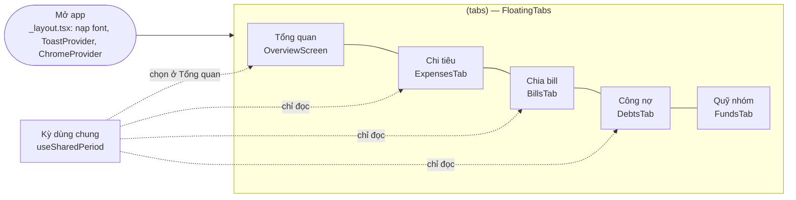
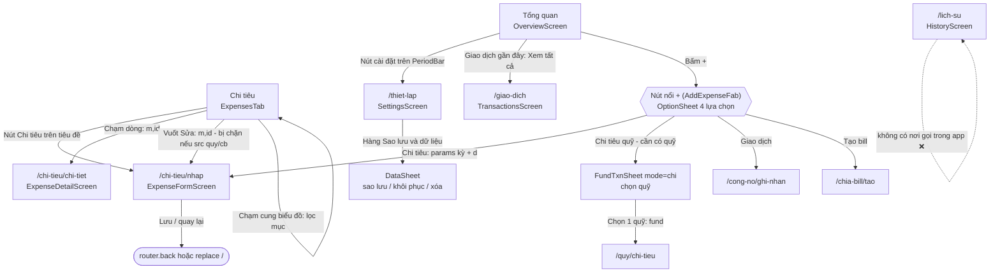
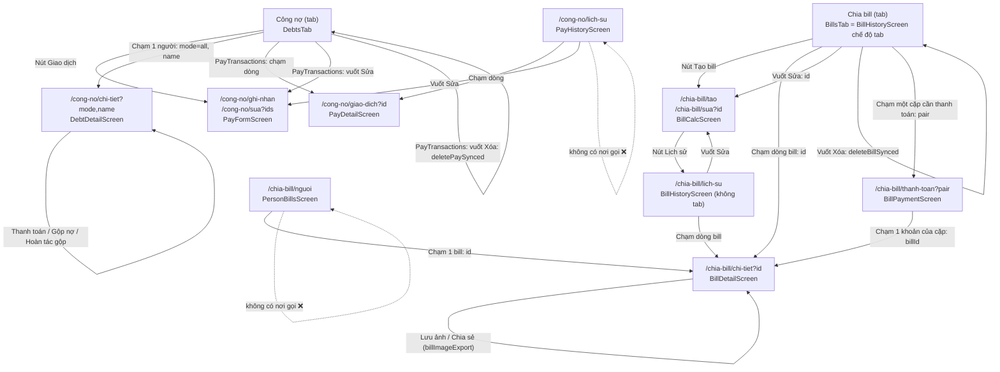
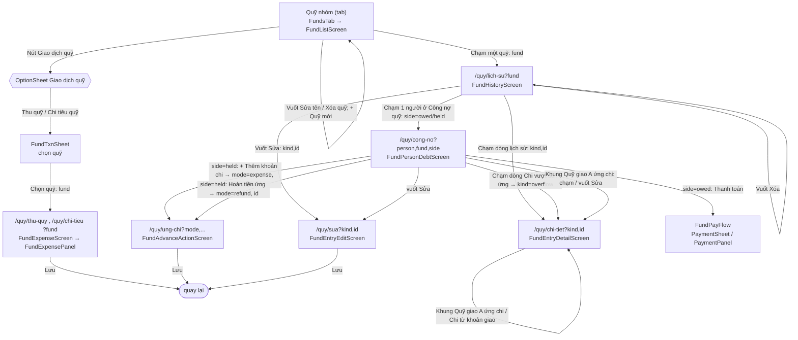
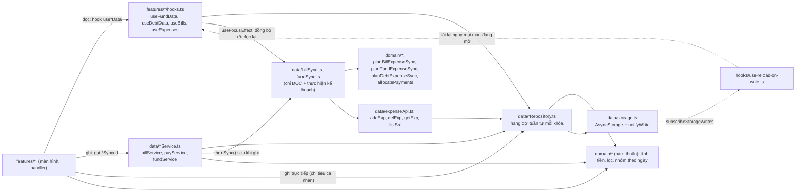
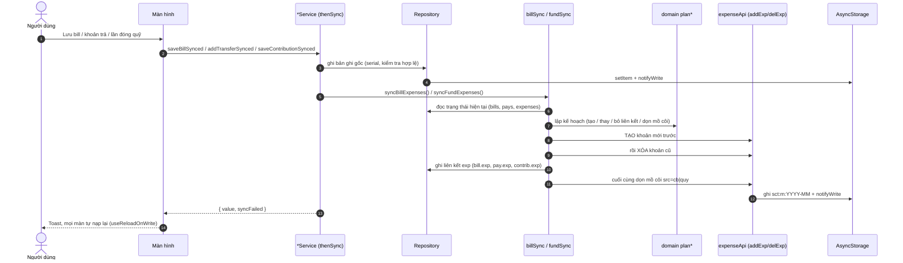
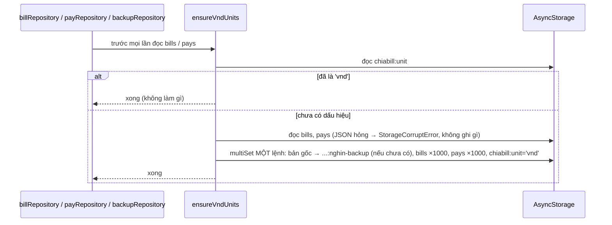

# Sơ đồ tổng quan ứng dụng Sổ Thu Chi Mobile

> Tài liệu khảo sát từ **mã nguồn thực tế** (không sửa code). Là cửa vào của bộ 4 tài liệu:
>
> | Tài liệu | Nội dung |
> |---|---|
> | **`SO-DO-TONG-QUAN.md`** (file này) | Quy ước, kho dữ liệu & đơn vị tiền, **Sơ đồ 1** (điều hướng), **Sơ đồ 3** (kiến trúc & luồng cập nhật dữ liệu) |
> | [`SO-DO-NGHIEP-VU.md`](SO-DO-NGHIEP-VU.md) | **Sơ đồ 2** — luồng nghiệp vụ A–F (Chi tiêu, Quỹ, Chia bill, Công nợ, Lịch sử, Tổng quan) |
> | [`SO-DO-TAI-SU-DUNG.md`](SO-DO-TAI-SU-DUNG.md) | **Sơ đồ 4** (component) và **Sơ đồ 5** (logic nghiệp vụ dùng chung), danh sách trùng lặp |
> | [`MA-TRAN-ANH-HUONG.md`](MA-TRAN-ANH-HUONG.md) | **Sơ đồ 6** (ma trận ảnh hưởng), rủi ro, chỗ tài liệu ≠ code, việc chưa xác minh |
>
> `KIEN-TRUC-DU-AN.md` là bản khung ban đầu (đã lỗi thời ở nhiều chỗ, xem mục 6 của `MA-TRAN-ANH-HUONG.md`); các tài liệu mới này thay thế phần mô tả hiện trạng.

## 0. Quy ước và mức xác minh

| Ký hiệu | Ý nghĩa |
|---|---|
| ✅ | Đã đối chiếu trực tiếp với code (đọc file, `grep` import/lời gọi). **Không** có nghĩa đã chạy trên máy thật. |
| ⚠️ | Có code nhưng chỉ suy ra từ chú thích/đọc code, chưa tái hiện bằng test hoặc chạy app. |
| ❓ | Chưa xác minh được. |
| ❌ | Thiếu, chết (không có nơi gọi) hoặc tài liệu ≠ code. |

- Mọi tên file, hàm trong tài liệu có thể tra ngược bằng `grep`. Đường dẫn tính từ gốc dự án (`src/...`).
- Sơ đồ viết bằng **Mermaid** (sửa trực tiếp bằng văn bản). Cạnh nối ghi **thao tác/điều kiện** gây ra chuyển màn.
- "Kỳ dùng chung" = `useSharedPeriod` (`src/hooks/use-shared-period.ts`), giá trị trong bộ nhớ phiên chạy, không lưu xuống máy.

## 1. Kho dữ liệu, đơn vị tiền, ba lớp bản ghi

Tất cả nằm trong `AsyncStorage` qua `src/data/storage.ts`. **Tên khóa giữ nguyên của PWA cũ** (`StorageKeys`).

| Khóa | Nội dung | Đơn vị tiền | Repository | Kiểu |
|---|---|---|---|---|
| `sct:settings` | ngân sách, mục chi tự thêm | đồng | `expenseRepository` | `ExpenseSettings` |
| `sct:m:YYYY-MM` | chi tiêu cá nhân, mỗi tháng một khóa, giá trị `{[id]: Expense}` | **đồng** (`Vnd`) | `expenseRepository` | `Expense` (`a,c,n,d,t,i?,src?`) |
| `quy_nhom_v1` | `funds, contribs, expenses, advances, fundTxns, cur` | **đồng** | `fundRepository` | `FundData` |
| `chiabill:v2:bills` | bill | **đồng** (`Vnd`; dữ liệu cũ lưu nghìn đồng được chuyển một lần, xem dưới) | `billRepository` | `Bill` |
| `chiabill:v2:pays` | khoản trả/chuyển tiền (Công nợ) | **đồng** | `payRepository` | `Pay` |
| `chiabill:unit` | dấu hiệu `'vnd'` = bill/khoản trả đã chuyển sang đồng | — | `data/moneyMigration` | chuỗi thô |
| `chiabill:v2:bills:nghin-backup`, `chiabill:v2:pays:nghin-backup` | bản gốc (nghìn đồng, nguyên văn) giữ lại khi chuyển đổi | nghìn đồng | `data/moneyMigration` | chuỗi thô |
| `chiabill:names` | nhóm người nhớ cho lần chia bill sau | — | `billRepository` | `string[]` |
| `sotien:people` | danh sách người dùng chung | — | `peopleRepository` | `string[]` |
| `chiabill:me`, `chiabill:v4:me` | cờ tương thích PWA, chỉ ghi khi khôi phục | — | `backupRepository` | — |

Điểm cần nhớ khi đọc mọi sơ đồ:

1. **Một đơn vị tiền duy nhất: ĐỒNG** (`Vnd`, số nguyên) cho cả Chi tiêu, Quỹ, Chia bill và Công nợ; hiển thị bằng `formatVnd`. Dữ liệu Chia bill/Công nợ cũ (nghìn đồng, PWA hoặc bản mobile trước) được `ensureVndUnits` (`src/data/moneyMigration.ts`) nhân 1000 **một lần** khi đọc lần đầu, có bản gốc dự phòng và dấu hiệu `chiabill:unit` (xem mục 3.4). Hàm đổi duy nhất còn lại là `nghinToVnd` trong `src/domain/moneyMigration.ts` (chỉ dùng cho chuyển đổi/khôi phục file cũ).
2. **"Tôi"** là chuỗi đúng `Tôi` (`FUND_OWNER_NAME` ở `src/domain/funds.ts`, `BILL_OWNER_NAME` là bí danh). Chỉ phần tiền của "Tôi" mới sinh khoản **chi tiêu cá nhân tự động**.
3. **Bản ghi tự sinh** trong chi tiêu cá nhân mang `src`: `'quy'` (từ phần "Tôi" của một lần đóng quỹ) hoặc `'cb'` (từ bill / khoản trả nợ bill). Liên kết ngược nằm ở `contrib.exp`, `bill.exp`, `pay.exp`. Khoản này **không** sửa/xóa trực tiếp được ở UI (`src/domain/linkedExpense.ts`).
4. **Không có DB quan hệ.** "Liên kết" giữa các kho chỉ là `ExpenseRef {m,id}` + hàm đồng bộ. Không có khóa ngoại cưỡng chế.

## 2. Sơ đồ 1 — Bản đồ điều hướng toàn ứng dụng

### 2.1 Điểm vào và 5 tab

Expo Router. `src/app/_layout.tsx` là `Stack` ẩn header (vuốt cạnh trái để quay lại); `(tabs)` dùng `FloatingTabs` (`src/components/floating-tabs.tsx`) với thứ tự **Tổng quan → Chi tiêu → Chia bill → Công nợ → Quỹ nhóm**.

Kỳ dùng chung được **chọn ở Tổng quan** (`PeriodBar` → `PeriodFilter`) và đọc ở: Tổng quan, Chi tiêu, Chia bill, `PayTransactions` (trong Công nợ), `/giao-dich`, `/chia-bill/thanh-toan`, `/quy/lich-su` (✅ `grep useSharedPeriod`). Công nợ (số dư) luôn tính **toàn thời gian**.

### 2.2 Tổng quan, Chi tiêu, Cài đặt

Ghi chú: `/lich-su` (`HistoryScreen`) không có `router.push('/lich-su')` nào (✅ `grep`); chỉ còn là route thủ công. `ExpenseRow` trong file này **vẫn được dùng** bởi `ExpensesTab`.

### 2.3 Chia bill và Công nợ

`BillHistoryScreen` có hai chế độ: **tab** (có `tab` prop: thẻ tổng quan bill, danh sách cặp cần thanh toán, lọc theo người) và **trang riêng** (`/chia-bill/lich-su`, kỳ lấy từ tham số route). Hai route `/chia-bill/nguoi` và `/cong-no/lich-su` không có nơi gọi vì các thành phần dẫn tới chúng (`BillDetailSection`, `PaysEntry`) đã không còn được dựng (xem `SO-DO-TAI-SU-DUNG.md`, mục 4). Mã hiển thị `PayRowView` của `PayHistoryScreen` vẫn được `PayTransactions` dùng.

### 2.4 Quỹ nhóm

`FundEntryEditScreen` (`kind` = `contribution | expense | advance | refund | payout`) dựng form tùy loại: `ContributionForm`, `FundExpenseForm` (sửa chi hoặc sửa hồ sơ giao ứng) hoặc `FundActionSheet asPage` (sửa hoàn tiền/thanh toán qua `txnEditTarget`).

### 2.5 Bảng route đầy đủ (đối chiếu `src/app` ↔ `_layout.tsx` ↔ nơi gọi)

| Route | File route → màn hình | Tham số | Mở từ (✅ đã `grep`) |
|---|---|---|---|
| `/` (tab index) | `(tabs)/index.tsx` → `OverviewScreen` | — | Tab; `router.replace('/')` khi "không có màn trước" |
| `/chi-tieu` (tab) | `(tabs)/chi-tieu.tsx` → `ExpensesTab` | — | Tab |
| `/chia-bill` (tab) | `(tabs)/chia-bill.tsx` → `BillsTab` | — | Tab |
| `/cong-no` (tab) | `(tabs)/cong-no.tsx` → `DebtsTab` | — | Tab |
| `/quy` (tab) | `(tabs)/quy.tsx` → `FundsTab` | — | Tab |
| `/chi-tieu/nhap` | `ExpenseFormScreen` | `m,id` (sửa); `periodToParams`; `d` (ngày gợi ý) | `ExpensesTab`, `OverviewScreen`, `HistoryScreen` (nút rỗng), `useExpenseRowActions.edit` |
| `/chi-tieu/chi-tiet` | `ExpenseDetailScreen` | `m,id` | `useExpenseRowActions.openDetail` |
| `/lich-su` | `HistoryScreen` | kỳ | ❌ không có nơi gọi |
| `/giao-dich` | `TransactionsScreen` | — | `RecentTransactions` ("Xem tất cả") |
| `/thiet-lap` | `SettingsScreen` | — | `OverviewScreen` → `PeriodBar.onSettings` |
| `/chia-bill/tao` | `BillCalcScreen` | — | `BillsTab`, `OverviewScreen` (FAB) |
| `/chia-bill/sua` | `EditBillRoute` → `BillCalcScreen` | `id` | `BillListCard` (vuốt Sửa) |
| `/chia-bill/chi-tiet` | `BillDetailScreen` | `id` | `BillListCard`, `BillPaymentScreen`, `PersonBillsScreen` |
| `/chia-bill/lich-su` | `BillHistoryScreen` (không tab) | kỳ | `BillCalcScreen` (nút Lịch sử) |
| `/chia-bill/thanh-toan` | `BillPaymentScreen` | `pair` (khóa cặp) | `BillHistoryScreen` (tab, thẻ cặp) |
| `/chia-bill/nguoi` | `PersonBillsScreen` | `person`, kỳ | ❌ không có nơi gọi |
| `/cong-no/ghi-nhan` | `PayFormScreen` (thêm) | — | `DebtsTab`, `OverviewScreen` (FAB), `PayHistoryScreen` (rỗng) |
| `/cong-no/sua` | `PayFormScreen` (sửa) | `ids` (phẩy) | `PayRowView` (vuốt Sửa) |
| `/cong-no/giao-dich` | `PayDetailScreen` | `id` | `PayRowView` (chạm dòng) |
| `/cong-no/chi-tiet` | `DebtDetailScreen` | `name`, `mode`, kỳ | `DebtsTab` → `DebtPeopleSection` |
| `/cong-no/lich-su` | `PayHistoryScreen` | kỳ | ❌ không có nơi gọi |
| `/quy/lich-su` | `FundHistoryScreen` | `fund` | `FundListScreen` |
| `/quy/thu-quy` | `FundExpenseScreen mode="thu"` | `fund` | `FundTxnSheet` |
| `/quy/chi-tieu` | `FundExpenseScreen` (mặc định chi) | `fund` | `FundTxnSheet` |
| `/quy/chi-tiet` | `FundEntryDetailScreen` | `kind,id` (`kind` thêm giá trị `overflow`) | `FundHistoryScreen`, `AdvanceSpendCard`, `FundPersonDebtScreen` |
| `/quy/sua` | `FundEntryEditScreen` | `kind,id` | `FundHistoryScreen`, `AdvanceSpendCard` |
| `/quy/ung-chi` | `FundAdvanceActionScreen` | `mode=expense` + `person,fund`; `mode=refund` + `id` | `FundPersonDebtScreen` |
| `/quy/cong-no` | `FundPersonDebtScreen` | `person,fund,side` | `FundHistoryScreen` |

`_layout.tsx` khai báo 24 `Stack.Screen` = `(tabs)` + 23 route con; `src/app` có đúng 23 file route con + 5 file tab (✅ đếm bằng `find` / `grep -c`, tên khớp từng cặp).

### 2.6 Popup / bottom sheet / modal (đều dựng bằng `SheetFrame` hoặc `Modal` + `ModalPresence`)

| Thành phần | Mở bởi | Đóng/Kết quả |
|---|---|---|
| `OptionSheet` "Chọn loại giao dịch" | `AddExpenseFab` | Chọn mục → gọi `onPress` của mục; chạm nền/Back = đóng |
| `OptionSheet` "Giao dịch quỹ" | `FundListScreen` (nút trên tiêu đề) | Chọn Thu quỹ / Chi tiêu quỹ → `FundTxnSheet` |
| `FundTxnSheet` | Tổng quan (Chi tiêu quỹ), `FundListScreen` | Chọn quỹ → `/quy/thu-quy` hoặc `/quy/chi-tieu`; không tạo giao dịch |
| `PeriodFilter` sheet | `PeriodBar`, `FundHistoryScreen` | Chọn tháng/năm/Tất cả/khoảng → `setView` (kỳ dùng chung) |
| `PaymentSheet` + `PaymentPanel` | `BillPaymentScreen`, `DebtDetailScreen`, `FundPayFlow`, `PersonBillsScreen`/`BillPairsPanel`/`DebtPeoplePanel` (dạng panel) | Thanh toán toàn bộ / một phần; thành công → ở lại trang, số liệu tự nạp lại |
| `SheetFrame` chọn hồ sơ ứng | `FundPersonDebtScreen` (Hoàn tiền ứng, >1 hồ sơ) | Chọn hồ sơ → `/quy/ung-chi?mode=refund` |
| `TopFormModal` | `FundActionSheet` (khi không `asPage`) | Form chi từ ứng/hoàn/thanh toán |
| `ConfirmDialog` | `FundExpenseForm` (2 hộp: thiếu tiền quỹ; xác nhận chia nguồn tiền) | Xác nhận → tiếp tục lưu |
| `PersonPicker`, `MemberPicker`, `OptionPicker` | `ContributionForm`, `FundExpenseForm`, `BillCalcScreen`, `PayFormScreen` | Chọn người/loại |
| `DataSheet` | `SettingsScreen` | Lưu/Sao chép sao lưu; Khôi phục (dán nội dung); Xóa dữ liệu từng phần (bấm hai lần xác nhận) |
| `Toast` (`ToastProvider`) | mọi màn khi lưu/xóa/lỗi | Có nút "Hoàn tác" cho xóa chi tiêu |

Cách quay lại: vuốt cạnh trái (native stack); các route form dùng `leave()` = `router.back()` nếu `canGoBack()`, ngược lại `router.replace('/')` (✅ lặp ở `chia-bill/sua|tao`, `cong-no/ghi-nhan|sua`, `ExpenseFormScreen`, `FundExpenseScreen`, `FundEntryEditScreen`, `FundAdvanceActionScreen`).

## 3. Sơ đồ 3 — Kiến trúc dữ liệu và luồng cập nhật

### 3.1 Các lớp thực sự có trong code

Quy tắc phụ thuộc (✅ theo import thực tế): `domain/` là hàm thuần (không đọc `AsyncStorage`); `data/` import `domain/`; `features/` import cả hai. Ngoại lệ đáng chú ý: `src/app/chia-bill/sua.tsx` gọi thẳng `loadBills()` (tầng route tự đọc dữ liệu).

### 3.2 Cơ chế "ghi → mọi màn cập nhật"

1. Ghi qua `saveJson*`/`saveManyJsonStrict`/`setRawMany`/`removeKeys` đều gọi `notifyWrite(keys)` (`src/data/storage.ts`).
2. `useReloadOnWrite(keys, reload)` (đăng ký trong `useFundData`, `useBills`, `useDebtData`, `useExpenses`, `useExpenseSettings`, `usePeople` (`features/people/hooks.ts`)) nghe và gom nhiều lần ghi thành một lần `reload()` (`setTimeout 0`). Màn hình **đang nằm phía sau** trong stack cũng tải lại ngay.
3. Ngoài ra mỗi hook dữ liệu dùng `useFocusEffect`: khi màn hình được mở/quay lại sẽ **chạy đồng bộ chi tiêu cá nhân rồi mới đọc lại** (giống PWA lúc khởi động). Lỗi đồng bộ bị nuốt; chỉ lỗi đọc/dữ liệu hỏng mới hiện lên màn.
4. Hàng đợi tuần tự **theo từng kho**: `billRepository`, `payRepository`, `expenseRepository`, `fundRepository` (`mutate` → `serial`) và `syncBillExpenses` / `syncFundExpenses` (`tail`). **Không có giao dịch xuyên kho** (xem rủi ro R-3 trong `MA-TRAN-ANH-HUONG.md`).

### 3.3 Chuỗi đồng bộ chi tiêu cá nhân

Thứ tự "tạo trước – xóa sau – ghi liên kết – dọn mồ côi" được chú thích ở đầu `billSync.ts`/`fundSync.ts`: dừng giữa chừng thì tệ nhất còn khoản mồ côi, lần đồng bộ sau tự dọn (✅ chú thích; ⚠️ chưa tái hiện sự cố giữa chừng).

### 3.4 Chuyển đơn vị nghìn đồng → đồng (một lần)

Chạy tuần tự (không nhân hai lần khi nhiều nơi đọc cùng lúc). Máy mới chỉ đặt dấu hiệu. Tạo sao lưu gọi với `markEmpty: false` nên không ghi gì khi chưa có dữ liệu. Khôi phục từ file: `parseBackup` đổi file cũ (`chiaBill.unit` thiếu hoặc `'k'`) sang đồng; file mới ghi `unit: 'd'`; `restoreFromText` đặt dấu hiệu cùng lúc với dữ liệu. Xoá dữ liệu Chia bill cũng xoá hai bản dự phòng.

### 3.5 Dữ liệu vào – nơi tính – nơi kiểm tra – nơi ghi (tóm tắt, chi tiết ở `SO-DO-NGHIEP-VU.md`)

| Nghiệp vụ | Tính toán | Kiểm tra hợp lệ | Ghi | Bản ghi liên kết |
|---|---|---|---|---|
| Chi tiêu cá nhân | `buildExpense` | `validateExpenseInput` (UI) + `addExp`/`ExpenseInputError` | `expenseRepository.addExpense/updateExpense` | — |
| Thu quỹ | `contributionSummary`, `buildContributionPeople` | `validateContribution` | `fundRepository.saveContribution` | `src:'quy'` (phần "Tôi") qua `fundSync` |
| Chi quỹ | `splitByCash`, `checkDirectSpend` | `validateFundExpense`, kiểm tra lại trong `saveFundExpense` | `fundRepository.saveFundExpense` | Không sinh chi tiêu cá nhân |
| Bill | `computeSplit` | `canSaveBill`, `BillInputError` | `billRepository.saveBill` | `src:'cb'` (phần "Tôi") qua `billSync` |
| Thanh toán bill | `buildBillPairs`, `pairAmountDraft` | `checkPairPayment` | `payRepository.appendPays` | `src:'cb'` "Trả ..." qua `allocatePayments` |
| Công nợ | `planDebtPayment`, `mergeDrafts` | `PayInputError` | `payRepository.appendPays` | tương tự |

## 4. Trạng thái chức năng (theo code, không theo kế hoạch)

| Khối | Trạng thái | Ghi chú |
|---|---|---|
| Tổng quan (thẻ tổng chi, 4 thẻ thống kê, giao dịch gần đây, nút +) | ✅ có code | Thẻ thống kê là `SummaryCard` **không bấm được** |
| Chi tiêu cá nhân (CRUD, lọc mục, hoàn tác xóa, ngân sách) | ✅ có code | Hoàn tác chỉ cho xóa |
| Quỹ nhóm: nhiều quỹ, thu quỹ, chi trực tiếp, cá nhân ứng chi (có chia nguồn tiền), giao tiền ứng, chi từ tiền ứng, hoàn tiền ứng, quỹ trả cá nhân | ✅ có code + test miền | Trang "Công nợ quỹ" tách `owed`/`held` |
| Chia bill (tạo/sửa, hệ số, mức cố định, danh sách, chi tiết, ảnh, cặp thanh toán) | ✅ có code | Xuất ảnh dùng `billImageExport` |
| Công nợ (2 sổ vay/bill, gộp nợ, thanh toán 4 lựa chọn, ghi nhận/sửa/xóa) | ✅ có code | |
| Cài đặt: ngân sách, mục chi, danh sách người, sao lưu/khôi phục/xóa | ✅ có code | Khôi phục bằng **dán nội dung**, không chọn file |
| Đồng bộ đám mây/API | ❌ **không có** | Chỉ `AsyncStorage` cục bộ |
| Tác vụ nền | ❌ không có | Chỉ đồng bộ khi mở màn hình/sau khi ghi |
| `recordPaymentSynced`, `recordPairPaymentSynced` (payService) | ❌ không có nơi gọi trong `features/` | Còn test (nếu có) |
